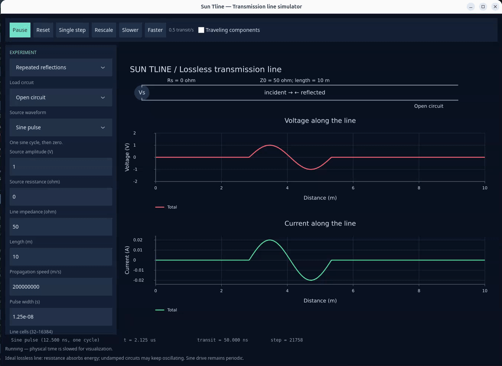

# Sun Tline



## Overview

A desktop transmission-line simulator written in Sun with `sun_ui`. Explore voltage
and current propagation, reflections, and settling on a lossless line.

## Install

Download a package from the private [development releases](https://github.com/namo-robotics/sun_tline/releases):

- **Apple Silicon macOS:** open the DMG and drag **Sun Tline.app** into **Applications**.
- **Linux x86-64:** install the Debian package with `sudo apt install ./sun-tline_amd64.deb`.

The macOS app is ad-hoc signed; trusted builds may require **Privacy & Security → Open Anyway**.

## Build from source

Install Sun, GTK4, librsvg, and `pkg-config`, then run:

```sh
./scripts/install-dependencies.sh
./build.sh --all
./build/sun_tline
```

See the [development guide](docs/development.md) for platform dependencies, tests, and packaging.

## Features

- Step, rectangular pulse, single-cycle sine pulse, and continuous sine sources.
- Open, short, resistor, capacitor, inductor, RC, RL, and RLC loads.
- Voltage/current plots with optional forward and reflected waves.
- Presets, live settings, pause, single-step, and playback speed controls.
